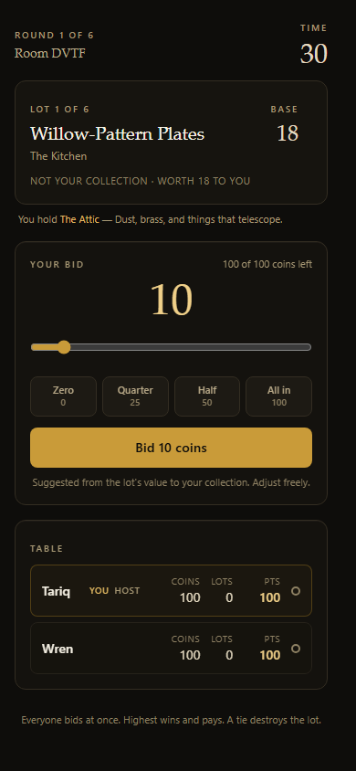
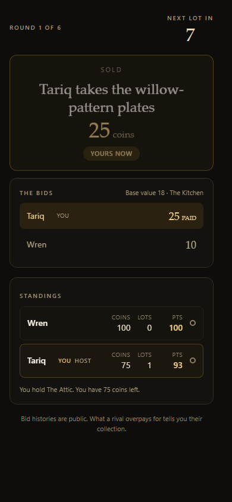
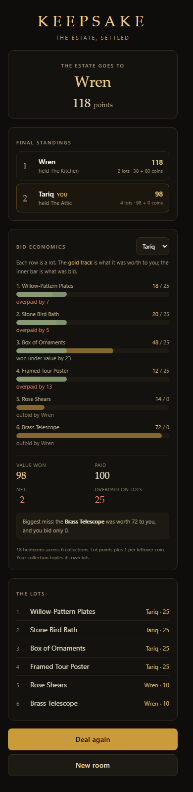
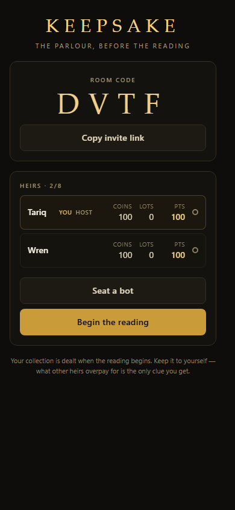

# KEEPSAKE

**A real-time sealed-bid auction party game for 2–8 players.**

Six heirlooms. Six sealed bids. Nobody shows their hand until the gavel falls.

[](https://github.com/tariq-k-dev/keepsake/actions/workflows/ci.yml)

**Live: [keepsake.tariq-k-dev.workers.dev](https://keepsake.tariq-k-dev.workers.dev)**

No accounts, no installs. Share a 4-letter code, play from any phone.

---

## The game

<p align="center">
  
  
  
</p>

<p align="center"><em>Bid in secret &rarr; the gavel falls &rarr; the estate is settled, and you see what every bid cost you.</em></p>

Grandmother left everything. The heirs are in the parlour, each with a secret favourite.

| #   | Rule                                                                                           |
| --- | ---------------------------------------------------------------------------------------------- |
| 1   | You start with **100 coins** and a **secret collection** only your screen shows.               |
| 2   | Each lot has a public base value — but it is worth **triple to whoever holds its collection**. |
| 3   | Everyone bids at once, in secret. Highest bid wins and pays exactly what they bid.             |
| 4   | A **tie destroys the lot**. Nobody scores, nobody pays.                                        |
| 5   | After six lots: value of what you won **plus leftover coins** decides the estate.              |

That is the whole game, and it produces the thing party games need: **a decision every round that
is genuinely hard.** You have a budget, unknown future lots, a secret that makes some lots worth
triple to you, and rivals whose bids leak information about what they value. What someone overpays
for is the only clue you get.

<p align="center">
  
</p>

<p align="center"><em>The lobby: one 4-letter code is the entire onboarding.</em></p>

### Playing alone

Click **Play now vs. bots** and you are in a game in one tap with three bot heirs. This matters
more than it sounds: every visitor from a portfolio link arrives alone, and a party game that
requires a party to demo gets closed in four seconds.

---

## Architecture

```
Browser (React 19 + Tailwind v4)
   │  WebSocket  ──────────────────────────────┐
   ▼                                           │
Cloudflare Worker  ── /api/room (mint code)    │  one deployable:
   │                ── /ws  (upgrade proxy)    │  static assets + realtime
   ▼                                           │
Durable Object  "RoomDO"  ◄────────────────────┘
   • the only writer for a room (no distributed race)
   • holds the authoritative RoomState in DO storage
   • resolves rounds, enforces the deadline via alarms
   • sends each client its OWN projection (the secrecy boundary)
```

### Why Durable Objects

A sealed-bid auction has exactly one hard requirement: **when the last player bids, everyone must
agree on the same outcome, in the same instant.** With a stateless server and a database, that is a
distributed-systems problem — two workers can each believe they saw the final bid.

A Durable Object is a single-threaded, single-instance actor per room. "Has everyone bid?" is a
local array check. Cloudflare guarantees one active instance and serialised storage access per
object, so there is no race to reason about. It is the smallest correct thing.

`ctx.acceptWebSocket()` (the **Hibernation API**) lets an idle room sleep while its sockets stay
open, so a room costs effectively nothing between games instead of billing duration for hours.

### Why a Worker and not Cloudflare Pages

Cloudflare's docs are explicit that **Durable Objects cannot be created inside a Pages project** —
a Pages Function can only bind to a DO that lives in a separate Worker. Since the entire game is one
DO per room, the app ships as a **single Worker with static assets**:

- one repository, one `wrangler deploy`
- `/ws` is same-origin — no CORS, no second domain, no second bill
- identical free tier (100k DO requests/day, SQLite-backed DOs included)

The Vite client build is unchanged, so a future move to Pages is a config swap, not a rewrite.

### Server authority

Clients send **intents**, never state:

```ts
{ t: 'bid', amount: 40 }   { t: 'start' }   { t: 'addBot' }   { t: 'rematch' }
```

The server validates, mutates `RoomState` through pure functions, and replies with a per-player
projection. **A rival's un-revealed bid is never serialised to your socket**, so secrecy is enforced
by construction rather than by hiding things in the UI. Bids are validated against `coins`; the
round deadline is enforced server-side; a non-bidder is auto-passed at 0.

## Tech stack

| Layer    | Choice                                 | Why                                            |
| -------- | -------------------------------------- | ---------------------------------------------- |
| UI       | React 19, TypeScript 6, Vite 8         | same stack as `tariqkhan.dev`                  |
| Styling  | Tailwind v4 (`@tailwindcss/vite`)      | no config file; theme tokens in `@theme`       |
| Realtime | WebSocket → Durable Object             | single writer per room, hibernation-cheap      |
| Rules    | pure TS module, no I/O                 | exhaustively testable; shared by bots and sims |
| Tests    | Vitest 5 + `@cloudflare/vitest-plugin` | engine in Node, room in real `workerd`         |
| Deploy   | Cloudflare Workers + Static Assets     | one deploy, same-origin sockets                |

Bundle: **~78 kB gzipped JS**, ~6 kB CSS. No router, no state library, no chart library — the
recap chart is hand-drawn SVG because 40 kB of plotting for one bar chart is not a trade worth making.

## The economy, and why the numbers are what they are

The rules fit in five lines. **Balancing them did not**, and guessing produces a game where bidding
is pointless. The first build used `COIN_CONVERSION = 0.2`, which a simulation immediately proved
broken: the winner took **94% of their score from lots**, so coins were nearly free, bidding became
a formality, and half the money in the game was never spent.

So `scripts/sweep.ts` grid-searches conversion rate × collection multiplier across thousands of
complete games, and reports whether any single bot strategy dominates, whether you can win by
hoarding, and what share of the winner's score comes from coins. The shipped cell
(**1.0 point per coin, 3× collection multiplier**) is the only one that keeps every archetype within
~1.4× of its fair share while holding coins at 22–31% of the winning score:

```
=== 4 players · 4,000 simulated games ===
lots sold              5.43 / 6
burned (tied)          9.4% of lots
winner item / coins    109.3 / 40.4     <- 73% lots, 27% coins
margin of victory      mean 22.0  median 17
VERDICT: HEALTHY — no strategy dominates.
```

CI enforces this: the `economy` job fails the build if a constant change makes the game degenerate,
so `docs/ECONOMY.md` cannot silently rot. Full derivation, including the failed first attempt and
the rejected parameter cells: **[docs/ECONOMY.md](docs/ECONOMY.md)**.

## Run it locally

**Requires** Node 24+, pnpm 12+, and a Cloudflare account only for deploying (not for local dev).

```bash
git clone https://github.com/tariq-k-dev/keepsake.git
cd keepsake
pnpm install
pnpm dev            # http://127.0.0.1:5173
```

`pnpm dev` runs the Vite client **and** the real Worker + Durable Object in local `workerd` via
`@cloudflare/vite-plugin`. There is no mock server to drift from production.

> **Note on `127.0.0.1`:** the dev server binds IPv4 explicitly. On Windows, Vite's default
> `localhost` binds `::1` only, while Chromium resolves `localhost` to `127.0.0.1` — which makes
> headless browser tests hang for 30 s per navigation.

### If rounds stop advancing

Symptom: the bidding screen sits there, the timer runs out, and nothing resolves. The dev server
log shows `jsg.Error: database is locked: SQLITE_BUSY` and `SQLite alarm handler canceled`.

This is **not a game bug**. Local Durable Object state lives in `.wrangler/state`, and if a
`workerd` runtime from an earlier session is still alive it holds those SQLite files. The new
server then cannot write, so alarms never fire. Killing a dev server's parent shell leaves the
runtime running surprisingly often.

```bash
node scripts/clean-dev.mjs          # report leftovers, refuse to start if any
node scripts/clean-dev.mjs --force  # stop them (supervisors first) and wipe local state
# or, both at once:
pnpm dev:clean
```

Verified: with a clean state, **8 concurrent full games run with zero lock errors**
(`PROBE_GAMES=8 node scripts/lock-probe.mjs`). If you see this in CI or production it means
something else — production Durable Objects are single-owner and cannot hit this.

### Try it with two players

1. Open `http://127.0.0.1:5173`, enter a name, click **Create a room**.
2. Note the 4-letter code, open the same URL in a second browser (or your phone on the same
   network with `--host`), enter a different name, type the code, click **Join**.
3. Both screens advance together — bids are hidden until every player has committed.

## Commands

| Command          | What it does                                              |
| ---------------- | --------------------------------------------------------- |
| `pnpm dev`       | Vite client + Worker + Durable Object in local `workerd`  |
| `pnpm dev:clean` | Kill leftover `workerd` processes and wipe local DO state |
| `pnpm build`     | Production build (client + worker)                        |
| `pnpm preview`   | Serve the production build in the Workers runtime         |
| `pnpm test`      | Both suites: rules engine (Node) + room DO (`workerd`)    |
| `pnpm test:cov`  | Same, with coverage                                       |
| `pnpm lint`      | ESLint, zero warnings tolerated                           |
| `pnpm typecheck` | `tsc --noEmit` for client and worker                      |
| `pnpm sim`       | Economy simulation at the shipped constants               |
| `pnpm sweep`     | Grid-search the economy parameters                        |
| `pnpm og`        | Regenerate the 1200×630 social card (`public/og.png`)     |
| `pnpm deploy`    | Build and deploy to Cloudflare                            |

## Testing

**Three test layers**, because each proves something the others cannot:

**`test/engine/` (Node, fast)** — the rules, exhaustively.

- every 2-player bid combination up to 6 coins: sole winner, tie-burns, unsold
- coin conservation across a full game (total coins = start − sums actually paid)
- a player can never bid coins they do not hold
- **the secrecy boundary**: another player's collection and un-revealed bid are `null` in the projection
- every lot in the deck is auctioned exactly once

**`test/room/` (real `workerd`)** — the live thing.

- real `WebSocketPair`, real DO storage, real alarms
- two clients play a complete 6-round game and converge on the same lot, winner, and price
- reconnect with a resume token returns you to **your** seat, not a new one
- a non-bidder is auto-passed when the deadline alarm fires
- a full game against a bot resolves every round

Both suites run in CI on every push (64 tests). A third, browser-level layer exists at
`scripts/e2e.mjs` — 18 assertions across two real Chromium contexts, including a 320 px overflow
check and the screenshots above. It needs a browser binary, so it runs manually; it was verified
against both `pnpm dev` and the real `wrangler dev` build.

## Configuration

Only one variable exists, and it is public: the origin used to build absolute
`og:image` / `og:url` URLs (crawlers do not resolve relative paths, and a relative
`og:image` silently produces **no** preview card).

| File              | Committed           | Purpose                                       |
| ----------------- | ------------------- | --------------------------------------------- |
| `.env.example`    | yes                 | template — copy to `.env` for local overrides |
| `.env.production` | yes                 | public build default; read by `vite build`    |
| `.env`            | **no** (gitignored) | your machine only                             |

`.gitignore` targets `.env` specifically rather than `.env*`, because a `.env*`
pattern would also drop `.env.production` — and then a fresh clone builds with an
empty origin, blank social tags, and no obvious error.

**Never put a secret in any `.env*` file that is committed.** `VITE_*` values are
inlined into the client bundle and are visible to anyone. Runtime secrets for the
Worker belong in `wrangler secret put`.

## Deploy

```bash
pnpm deploy
```

`wrangler.jsonc` declares the route, the `ROOMS` DO binding, and the `v1`
`new_sqlite_classes` migration. First deploy creates the namespace; subsequent
deploys reuse it. To attach a custom domain, add a `routes` entry with
`custom_domain: true` and point DNS at Cloudflare.

CI does not deploy — deploys are deliberate, from a machine that has the account.

## Project layout

```
src/
  shared/          rules engine — imported by the client, the DO, the tests AND the sims
    constants.ts   every tunable number (see docs/ECONOMY.md)
    catalog.ts     18 heirlooms across 6 collections
    engine.ts      pure: deal, placeBid, resolveRound, score, viewFor
    bots.ts        three archetypes; the same code the live room runs
    types.ts       wire protocol
  worker/
    index.ts       routes: /api/room, /ws, /api/health, then static assets
    room.ts        the Durable Object
  client/
    lib/           socket (reconnect + resume), session store, router
    screens/       Landing, Lobby, Bidding, Reveal, Recap
    components/    UI primitives
test/              engine (Node) + room (workerd)
scripts/           simulate, sweep, e2e
docs/ECONOMY.md    the balance derivation
docs/screenshots/  the images above
```

## Design notes

- **The recap is the portfolio piece.** After the game, every player sees a bar per lot: what it
  was worth _to them_ against what they paid, plus a net position and their biggest miss. A bidding
  game ends with an analysis of your own bidding.
- **Colour carries meaning once.** Burnt red appears only on a destroyed lot. Nothing else in the
  interface uses it, so it does not need a label.
- **Contrast is measured, not eyeballed.** Every text colour was checked against WCAG 2.1 AA against
  the darkest surfaces; the ratios live in a comment in `src/client/index.css`. An earlier palette
  had the rules copy at 2.0:1 — technically invisible to a lot of players.
- **Nothing is disabled that a player needs.** A broke player still has a working pass button,
  because passing _is_ a bid and the round cannot resolve without it.
- **A number that reads as a verdict must be one.** The recap once showed "overpaid by 14" beside
  "value won 126 / paid 100", reading as a loss when the player was 26 up — it summed only lots
  bought above value and ignored the bargains. It now shows an explicit net.

## Licence

MIT
